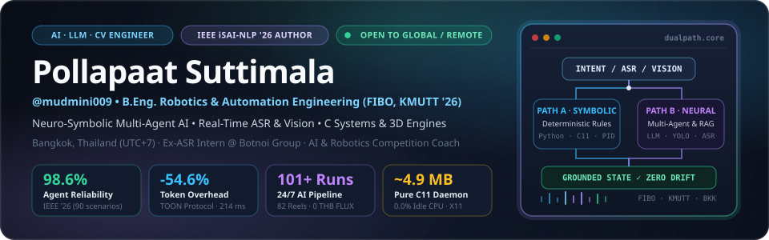
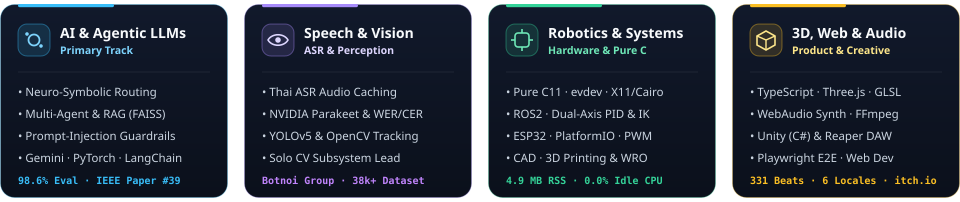
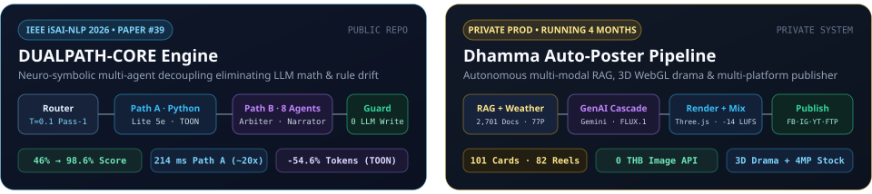

  

 

[Core Pillars](#-core-engineering-pillars) &nbsp;•&nbsp; [Flagship Architecture](#-research--production-spotlight) &nbsp;•&nbsp; [Experience](#-experience--education) &nbsp;•&nbsp; [Selected Projects](#-selected-projects) &nbsp;•&nbsp; [Tech Stack](#-technical-stack) &nbsp;•&nbsp; [Connect](#-lets-build-together)

 

**AI, LLM & Computer Vision Engineer** with a **B.Eng. in Robotics & Automation Engineering (FIBO, KMUTT '26)** and a **first-author paper presented at IEEE iSAI-NLP 2026**.  
I design **reliable, production-grade AI systems** — uniting neuro-symbolic multi-agent orchestration, real-time Thai speech & machine vision pipelines, and low-latency **C / Python / TypeScript** engineering.  
*Based in **Bangkok, Thailand (UTC+7)** — open to **top-tier local roles**, **global remote**, and **international relocation**.*

---

## ⚡ Core Engineering Pillars

  

---

## 🚀 Research & Production Spotlight

  

<strong>1. IEEE iSAI-NLP 2026 First-Author Research — <code>DUALPATH-CORE</code> (Public)</strong>

- **Conference:** Presented in person (Nov 19, 2026, Bangkok) at the *21st International Joint Symposium on Artificial Intelligence and Natural Language Processing (IEEE iSAI-NLP 2026)* — **Paper ID #39** (`Pollapaat Suttimala`, `Suriya Natsupakpong`, `Paisit Khanarsa`).
- **Core Innovation:** Eliminates LLM arithmetic drift, hallucinated state mutations, and sycophantic prompt-injection exploits by strictly isolating **Path A (deterministic Python `Lite 5e` rules)** from **Path B (8 task-calibrated LLM sub-agents)** with zero direct LLM write access to game state.
- **Measured Impact:** Improved overall reliability from **`46.0% → 98.6%`** across a 90-scenario / 360-check benchmark, boosted state synchronization **`9.5% → 94.4%`**, reduced combat payload tokens **`-54.6%`** via pipe-delimited **TOON** serialization, and achieved **`214 ms`** average Path A latency (~20× faster than monolithic LLM baselines), validated by a blind A/B human pilot (`N = 6`).
- **Next Milestone:** Expanding the validated engine architecture into a full graphical indie RPG built for **Steam**.

<strong>2. Autonomous Multi-Modal AI Media Engine — <code>dhamma-auto-poster</code> (Private • Live ~4 Months)</strong>

- **Production Scale:** Running autonomously in production since **August 2026** — **101+** generated daily editorial cards, **82+** vertical 9:16 Reels/Shorts, **81** tracked YouTube Shorts uploads, **17** Adobe Stock 4MP exports, and a **24 fps Three.js + Playwright** weekly 3D Chibi Drama pipeline.
- **Grounded Multi-Modal Pipeline:** Combines **2,701** canonical Buddhawajana suttas (boundary-verified RAG + 90-day rolling memory), **77-province** live Open-Meteo weather telemetry, PyThaiNLP dynamic-programming balanced Thai text wrapping, and **Cloudflare Workers AI (`FLUX.1 Schnell`)** at **0 THB image API cost** with automated Gemini multi-tier failover.
- **Audio & WebGL Engineering:** Synthesizes parallel SwiftShader WebGL frames, emotion-aware neural Thai TTS with episode-wide same-gender voice locking, and FFmpeg **EBU R128 (`-14 LUFS`)** sidechain-ducked mastering before dispatching directly to Facebook, Instagram, YouTube Shorts, Discord, and Adobe Stock FTP.

---

## 💼 Experience & Education

| Role & Organization | Focus & Verified Impact |
| :--- | :--- |
| **AI Engineer Intern (ASR Team)** — *Botnoi Group* | Optimized real-time **Thai Automatic Speech Recognition (ASR)** inference via low-latency **NVIDIA Parakeet** audio caching and ran systematic **WER / CER** accuracy & throughput benchmarking *(Year 3–4 KMUTT break)*. |
| **Robotics & Coding Instructor** — *AI Kids* | Mentored students (ages **8–13**) in **advanced robotics competition coaching** across **ROS2, Python, VEX, and LEGO SPIKE** hardware/software systems. |
| **Freelance CAD & 3D Printing Engineer** | Delivered custom mechanical CAD modeling (**SolidWorks / Fusion 360**), bespoke functional 3D prints, and 3D printer hardware calibration & diagnostics. |
| **B.Eng. Robotics & Automation Engineering** — *FIBO, KMUTT* | Graduated **Class of 2026** (*Institute of Field Robotics*, King Mongkut's University of Technology Thonburi; Royal Commencement March 2027). Competed in **WRO**, Robot Battle, and **IBM Granite GenAI Hackathon**. |

---

## 📂 Selected Projects

### Public Repositories

| Project | Stack & Domain | Engineering Highlights |
| :--- | :--- | :--- |
| **[DualPath-Core-TTRPG-engine](https://github.com/mudmini009/DualPath-Core-TTRPG-engine)** | `Python` · `Multi-Agent AI` · `IEEE '26` | Neuro-symbolic hybrid engine with 8 calibrated sub-agents, BFS quest graph self-healing, TOON serialization (`-54.6%` tokens), `98.6%` benchmark reliability, and full conference/thesis artifacts. |
| **[MechAim-CV](https://github.com/mudmini009/MechAim-CV)** | `YOLOv5` · `PyTorch` · `PID/IK` · `ESP32` | End-to-end physical CV targeting robot trained on **38k+ custom images (Tesla V100)** driving a custom CAD-designed Mecanum chassis via dual-axis PID & Inverse Kinematics. |
| **[winpad-x11](https://github.com/mudmini009/winpad-x11)** | `Pure C11` · `evdev` · `X11 / Cairo` | Windows 10/11 Precision Touchpad ergonomics & live `XComposite` Task View for Linux XFCE — **`~4.9 MB` RSS, `0.0%` idle CPU**, zero `xdotool`/scripting bloat, GitHub CI & MIT licensed. |
| **[granite-hack](https://github.com/FaRinZZZZ/granite-hack)** | `LangChain` · `FAISS` · `IBM WatsonX` | *IBM Granite GenAI Hackathon* — Engineered the **advanced RAG pipeline, store location routing, and promotion recommendation engine** powering the `Granite-chan` assistant. |
| **[glass-ministry](https://github.com/mudmini009/glass-ministry)** | `TypeScript` · `Three.js` · `GLSL` · `Playwright` | 100% procedural 3D political-noir visual novel (5 Acts, 331 beats, 5 endings, 6 locales / 1,042 keys, procedural WebAudio, `331/331` automated Playwright WebGL sightline QA). **[Play on itch.io](https://mudmini009.itch.io/glass-ministry)** |
| **[nvim-config-init-lua](https://github.com/mudmini009/nvim-config-init-lua)** | `Lua` · `Neovim` · `LSP / DAP` | Cross-platform (Linux / Windows / macOS) lazy-loaded Neovim configuration achieving **~70 ms** warm startup across 22 plugins with bytecode caching and SSH OSC-52 clipboard. |

### Private, R&D & Multidisciplinary Systems

- **Solo Machine Vision Lead — *FIBO Group Robotics Project***: Architected and implemented the entire real-time machine vision perception subsystem independently inside a multi-disciplinary university robotics team.
- **Autonomous AI VTuber / Companion Prototype *(Private • Early R&D)***: Built an end-to-end **Neuro-sama–inspired** real-time conversational AI character prototype early in the generative agent wave, integrating live dialogue loops and persona control.
- **Construction Business Web Platform *(In Development)***: Designing and building a full-stack commercial web presence and client operations site for a family construction enterprise.
- **[Ashen Paws: Prologue](https://mudmini009.itch.io/ashen-paws) *(Unity C# • itch.io)***: 2D dark-fantasy souls-like prototype — personally composed & produced **original game audio/music in Reaper DAW**, UI/UX, narrative, and level design.

---

## 🛠️ Technical Stack

  
  
  
  
  
  
  

  
  
  
  
  
  
  

  
  
  
  
  
  
  

---

## 🤝 Let's Build Together

Open to **AI / LLM Engineer**, **Machine Learning / Computer Vision Engineer**, **Robotics Software Engineer**, and **Systems / Research Engineer** roles (**Bangkok**, **Global Remote**, or **International Relocation**).

- **Email:** [`mudnott@gmail.com`](mailto:mudnott@gmail.com)
- **itch.io Portfolio:** [mudmini009.itch.io](https://mudmini009.itch.io)
- **YouTube / Audio:** [@mudmini009](https://www.youtube.com/c/mudmini009) · [SoundCloud (MDBOYZ)](https://soundcloud.com/mdboyz)
