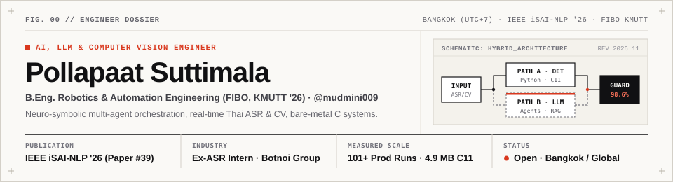
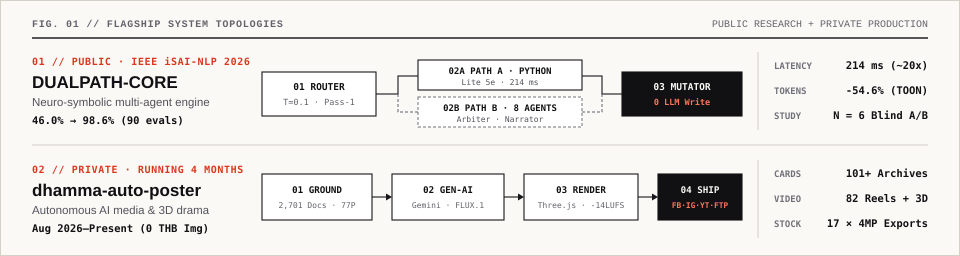

<picture>
  <source media="(prefers-color-scheme: dark)" srcset="assets/header-dark.svg" />
  <source media="(prefers-color-scheme: light)" srcset="assets/header-light.svg" />
  
</picture>

  <a href="https://github.com/mudmini009/DualPath-Core-TTRPG-engine/blob/master/docs/conference/IEEE_Paper39_Final_Manuscript.pdf">IEEE iSAI-NLP '26 Paper #39 (PDF)</a> &nbsp;·&nbsp;
  <a href="https://mudmini009.itch.io">itch.io</a> &nbsp;·&nbsp;
  <a href="https://www.youtube.com/c/mudmini009">YouTube</a> &nbsp;·&nbsp;
  <a href="https://soundcloud.com/mdboyz">SoundCloud</a> &nbsp;·&nbsp;
  <a href="mailto:mudnott@gmail.com">mudnott@gmail.com</a>

**AI, LLM & Computer Vision Engineer** — B.Eng. in Robotics and Automation Engineering (**FIBO, KMUTT '26**), first-author **IEEE iSAI-NLP 2026** presenter, and former **Botnoi Group** ASR Engineering Intern. I design systems where probabilistic AI models are bounded by deterministic verification, real-time speech/vision pipelines, and bare-metal **Python / C11 / TypeScript** engineering. Based in **Bangkok (UTC+7)** — open to **local**, **global remote**, and **international relocation** roles.

---

### Research & Production Architecture

<picture>
  <source media="(prefers-color-scheme: dark)" srcset="assets/architecture-dark.svg" />
  <source media="(prefers-color-scheme: light)" srcset="assets/architecture-light.svg" />
  
</picture>

- **DUALPATH-CORE — IEEE iSAI-NLP 2026 (`Paper ID #39`, Public):** Presented in person in Bangkok (Nov 19, 2026; *Pollapaat Suttimala, Suriya Natsupakpong, Paisit Khanarsa*). Decouples deterministic Python `Lite 5e` mechanics (`Path A`) from 8 calibrated LLM sub-agents (`Path B`) with zero direct LLM write access to state. Raised 90-scenario benchmark reliability from **`46.0%` to `98.6%`**, state sync **`9.5%` to `94.4%`**, cut combat payloads **`-54.6%`** via pipe-delimited **TOON** serialization, and averaged **`214 ms`** Path A latency (~20× faster than monolithic baselines), verified by a blind A/B pilot (`N = 6`). Next phase: expanding into a graphical indie RPG targeting **Steam**.
- **`dhamma-auto-poster` (Private Production • Running Aug 2026–Present):** Autonomous multi-modal content and WebGL drama pipeline running continuously in production — **101+** daily editorial cards, **82+** vertical 9:16 Reels/Shorts, **81** tracked YouTube Shorts uploads, and **17** 4MP Adobe Stock exports. Grounded in **2,701** boundary-verified Buddhawajana suttas, live **77-province** Open-Meteo telemetry, PyThaiNLP dynamic-programming balanced Thai text wrapping, **0 THB** image synthesis via Cloudflare Workers AI (`FLUX.1 Schnell`) with Gemini failover, parallel SwiftShader Three.js 3D Chibi rendering, and FFmpeg **-14 LUFS** broadcast audio mastering with same-gender TTS provider locking.

---

### Selected Work

| Project | Domain | Summary & Measured Output | Stack |
| :--- | :--- | :--- | :--- |
| **[DualPath-Core-TTRPG-engine](https://github.com/mudmini009/DualPath-Core-TTRPG-engine)** | Neuro-Symbolic AI | IEEE iSAI-NLP '26 Paper #39 & FIBO Senior Thesis; BFS quest healing, 8 agents, `98.6%` benchmark score. | `Python` `Gemini` `TOON` |
| **[winpad-x11](https://github.com/mudmini009/winpad-x11)** | Systems / Linux | Windows 10/11 Precision Touchpad gestures & live `XComposite` Task View for XFCE (`~4.9 MB` RSS, `0.0%` idle CPU, CI, MIT). | `Pure C11` `evdev` `X11` `Cairo` |
| **[MechAim-CV](https://github.com/mudmini009/MechAim-CV)** | Vision & Robotics | Physical CV targeting rig trained on **38k+ images (Tesla V100)** driving a custom CAD Mecanum chassis via dual-axis PID & IK. | `YOLOv5` `PyTorch` `ESP32` `PID/IK` |
| **[granite-hack](https://github.com/FaRinZZZZ/granite-hack)** | Applied RAG | *IBM Granite GenAI Hackathon* — Engineered the advanced RAG pipeline, indoor location routing, and promotion recommender. | `LangChain` `FAISS` `WatsonX` |
| **[glass-ministry](https://github.com/mudmini009/glass-ministry)** | 3D Engine / WebGL | Procedural 3D visual novel engine: 5 Acts, 331 beats, 5 endings, 6 locales (`1,042` keys), procedural WebAudio, `331/331` Playwright E2E QA. [Play](https://mudmini009.itch.io/glass-ministry) | `TypeScript` `Three.js` `GLSL` |

#### Private, R&D & Multidisciplinary Systems

- **Solo Machine Vision Lead (FIBO Group Project):** Owned end-to-end computer vision detection and tracking independently inside a multi-disciplinary robotics team.
- **Autonomous AI VTuber Prototype *(Private · Early R&D)*:** Built a Neuro-sama–inspired real-time conversational AI companion and streaming persona loop prior to mainstream agent tooling.
- **Construction Business Web Platform *(In Development)*:** Designing and building a commercial business website for family construction operations.
- **[Ashen Paws: Prologue](https://mudmini009.itch.io/ashen-paws) *(Unity C# · itch.io)*:** 2D souls-like prototype — personally composed and designed **original audio & music in Reaper DAW**, UI/UX, narrative, and level design.

---

### Experience & Education

| Role | Organization | Scope |
| :--- | :--- | :--- |
| **AI Engineer Intern (ASR Team)** | **Botnoi Group** | Built and tuned low-latency real-time **Thai ASR** audio caching (**NVIDIA Parakeet**) and ran systematic **WER / CER** accuracy benchmarks *(Year 3–4 KMUTT break)*. |
| **Robotics & Coding Instructor** | **AI Kids** | Coached students ages **8–13** for **advanced robotics competitions** across `ROS2`, `Python`, `VEX`, and `LEGO SPIKE`. |
| **Freelance CAD & 3D Printing** | **Independent** | Delivered custom mechanical CAD (`SolidWorks` / `Fusion 360`), functional 3D-printed parts, and printer hardware diagnostics & repair. |
| **B.Eng. Robotics & Automation** | **FIBO, KMUTT** | Graduated **Class of 2026** (*Institute of Field Robotics*; Royal Commencement March 2027). Competed in **WRO**, Robot Battle, and **IBM Granite GenAI Hackathon**. |

---

### Core Stack

- **AI, Speech & Vision:** `Python` · `PyTorch` · `Gemini & LLMs` · `Multi-Agent Systems` · `RAG / FAISS / LangChain` · `NVIDIA Parakeet (ASR)` · `WER/CER` · `YOLOv5` · `OpenCV`
- **Robotics & Low-Level Systems:** `C (C11 / POSIX)` · `C++` · `Linux evdev / X11 / XComposite` · `ROS2` · `ESP32 / PlatformIO` · `PID & Inverse Kinematics` · `SolidWorks / Fusion 360`
- **3D, Web & Audio Engineering:** `TypeScript` · `Three.js & GLSL` · `WebAudio` · `Unity (C#)` · `Playwright E2E` · `FFmpeg (-14 LUFS)` · `Reaper DAW` · `Neovim (Lua)`
